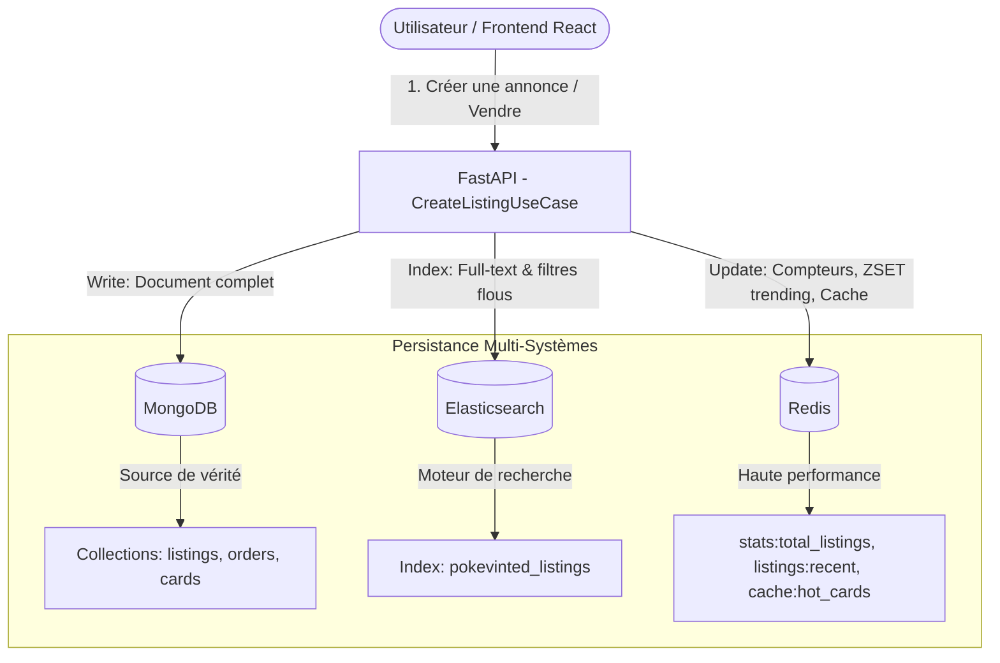

# 🎴 PokéVinted — Architecture & Plan d'Implémentation

> **Projet NoSQL ENSIIE S3**  
> **Concept :** Marketplace de cartes Pokémon style *Vinted / Cardmarket* (achat, vente, recherche avancée, back-office admin avec métriques en temps réel).  
> **Stack :** React (Vite) + FastAPI (Python DDD/TDD) + MongoDB + Elasticsearch + Redis + Grafana + Docker Compose.

---

## 1. Architecture Logicielle & DDD (Domain-Driven Design)

Le backend est structuré selon les principes de la **Clean Architecture / DDD** afin d'isoler la logique métier des détails d'infrastructure :

```text
backend/
├── app/
│   ├── domain/               # CŒUR MÉTIER PUR (Aucune dépendance externe)
│   │   ├── entities/         # Card, Listing (Annonce), Order (Transaction), User
│   │   ├── value_objects/    # CardCondition (Mint, NearMint...), Price, SetInfo
│   │   ├── repositories/     # Interfaces abstraites (ListingRepository, SearchRepository, CacheRepository)
│   │   └── exceptions/       # Erreurs métier (ListingAlreadySold, CardNotFound...)
│   │
│   ├── application/          # CAS D'UTILISATION (Use Cases & Orchestration)
│   │   ├── use_cases/
│   │   │   ├── create_listing.py   # Persistance multi-systèmes (Mongo + Elastic + Redis)
│   │   │   ├── search_listings.py  # Recherche Elastic avec fallback / filtres
│   │   │   ├── purchase_listing.py # Achat + transition d'état + invalidation cache
│   │   │   └── get_admin_stats.py  # Métriques combinées (Mongo, Redis, Elastic)
│   │   └── dtos/             # Schémas de validation et transfert de données
│   │
│   ├── infrastructure/       # ADAPTATEURS EXTERNES & STOCKAGE
│   │   ├── persistence/
│   │   │   ├── mongo/        # MongoListingRepository, MongoOrderRepository (motor / pymongo)
│   │   │   ├── elastic/      # ElasticSearchRepository (elasticsearch-py)
│   │   │   └── redis/        # RedisCacheRepository (redis-py : cache, zset, stats)
│   │   └── seed/             # Script d'importation de vraies cartes TCG avec images HD
│   │
│   └── interfaces/           # COUCHE D'ENTRÉE
│       ├── api/              # Contrôleurs FastAPI (routes: /cards, /listings, /orders, /admin)
│       └── dependencies.py   # Injection des dépendances
└── tests/                    # TESTS AUTOMATISÉS (TDD)
    ├── unit/                 # Tests unitaires du domaine & use cases (mocks)
    └── integration/          # Tests d'intégration avec Mongo, Elastic, Redis réels
```

---

## 2. Rôle Précis & Synergie des 3 Systèmes NoSQL

Chaque système NoSQL est exploité pour ses points forts réels, sans redondance artificielle :



| Système | Rôle Clé | Ce que le Professeur pourra inspecter en terminal |
| :--- | :--- | :--- |
| **MongoDB** | **Source de vérité (Document Store)** : Stocke les fiches détaillées des annonces, des cartes de référence, l'historique immuable des transactions et états (`ACTIVE`, `SOLD`). | `mongosh`<br>`use pokevinted`<br>`db.listings.find().pretty()` |
| **Elasticsearch** | **Moteur de recherche (Search Engine)** : Indexation textuelle pour recherche floue (nom du Pokémon avec fautes de frappe, extension, illustrateur, rareté, tranche de prix). | `curl -X GET "http://localhost:9200/pokevinted_listings/_search?q=dracaufeu&pretty"` |
| **Redis** | **Cache & Temps Réel (Key-Value / Data Structures)** : Compteurs atomiques de transactions, liste ordonnée (`ZSET`) des cartes les plus vues/populaires, verrous distribués pour éviter les doubles achats simultanés. | `redis-cli`<br>`GET stats:total_sales`<br>`ZRANGE marketplace:trending 0 5 WITHSCORES` |

---

## 3. Workflow de la Consigne Enseignant (Formulaire & Double Persistance)

Lorsqu'un utilisateur soumet le formulaire **"Mettre une carte en vente"** :
1. **Validation Métier** : vérification des données (prix > 0, état valide, référence Pokémon existante).
2. **Étape 1 (MongoDB)** : insertion de l'entité `Listing` complète avec identifiant UUID unique.
3. **Étape 2 (Elasticsearch)** : indexation synchrone du document pour recherche immédiate.
4. **Étape 3 (Redis)** :
   * Incrémentation atomique du nombre total d'annonces en ligne (`INCR stats:active_listings`).
   * Ajout de l'annonce dans la liste des nouveautés (`LPUSH listings:recent <id>`).
   * Invalidation du cache des annonces d'accueil.
5. **Résultat pour la soutenance** : Deux terminaux ouverts montrent instantanément la donnée apparue dans Mongo et dans Elasticsearch.

---

## 4. Expérience Frontend (UI / UX Vinted Spéciale Pokémon)

Une interface moderne, réactive et percutante (thème sombre élégant avec accents holographiques) :
* **Header & Navigation** : Barre de recherche intelligente avec auto-complétion, bouton *"Vendre une carte"* mis en valeur, sélecteur de mode.
* **Effet Carte Holographique 3D** : Au survol d'une carte, effet de brillance dynamique et inclinaison tilt (CSS 3D transform + reflets irisés).
* **Catalogue Marketplace** : Grille avec filtres avancés (Sets récents: *Écarlate et Violet, 151, Flammes Obsidiennes*, Rareté: *Ultra Rare, Illustration Spéciale*, État: *Mint, Near Mint*, Prix min/max).
* **Modal / Page de Vente ("Formulaire d'Annonce")** :
  * Sélection intuitive de la carte via l'API/Catalogue de base (autocomplétion par nom).
  * Sélection de l'état avec guide visuel explicatif.
  * Définition du prix de vente avec rappel du prix moyen de marché fictif/réel.
  * Description et photo personnalisée (optionnelle, sinon image HD officielle).
* **Fiche Détail & Achat Express** :
  * Visualisation HD grand format.
  * Bouton "Acheter maintenant" (déclenche la transition `ACTIVE -> SOLD`, enregistre la commande dans Mongo + Elastic + incrémente les ventes dans Redis).
* **Tableau de Bord Admin (Bilan)** :
  * KPI Cards : Total des ventes en €, Nombre d'annonces actives, Utilisateurs/vendeurs actifs.
  * État de santé des 3 stockages (Ping Mongo, Elastic cluster health, mémoire Redis).
  * Top 5 des cartes les plus recherchées / vendues.

---

## 5. Environnement Docker Compose & Observability

Tous les services démarrent avec une seule commande `docker compose up --build` :

1. **`backend`** : FastAPI (Python 3.11), reload actif, endpoints documentés sur `/docs`.
2. **`frontend`** : React (Vite/Nginx), port 3000 ou 5173.
3. **`mongodb`** : Image officielle Mongo 7, initialisation de la base `pokevinted`.
4. **`elasticsearch`** : Elasticsearch 8 en mode single-node, prêt à l'emploi.
5. **`redis`** : Redis 7 Alpine.
6. **`grafana`** : Port 3001, dashboard de supervision préconfiguré.
7. **`seed-runner`** (Job de démarrage) : Script Python qui peuple automatiquement le catalogue avec les 100 cartes les plus populaires des sets récents et leurs images HD officielles, pour que l'app soit immédiatement vivante.

---

## 6. Feuille de Route d'Exécution (Méthode TDD)

- [ ] **Phase 1 : Socle Docker & Configuration**
  - Écriture du `docker-compose.yml` complet avec les 3 bases + backend + frontend + grafana.
  - Configuration des variables d'environnement (`.env`).
- [ ] **Phase 2 : Domaine & Infrastructure Backend (DDD)**
  - Entités métier (`Card`, `Listing`, `Order`).
  - Connecteurs & Repositories (`MongoRepository`, `ElasticRepository`, `RedisRepository`).
  - Script de Seed (téléchargement et injection d'un pack de cartes TCG avec images HD).
- [ ] **Phase 3 : Use Cases & Tests (TDD)**
  - Tests unitaires et d'intégration avec `pytest`.
  - Implémentation des Use Cases (`CreateListing`, `SearchListings`, `BuyListing`, `GetStats`).
  - Routes FastAPI exposées et testées.
- [ ] **Phase 4 : Frontend React (UI/UX Moderne)**
  - Initialisation de l'application React avec design system épuré.
  - Composants : Carte 3D Tilt, Catalogue avec filtres, Formulaire de mise en vente multi-étapes.
  - Flow d'achat & Page Admin Bilan.
- [ ] **Phase 5 : Documentation, Tests de soutenance & Prêt pour VPS**
  - Guide pas-à-pas pour la soutenance (commandes terminal exactes pour le prof).
  - Script de vérification automatisé.
