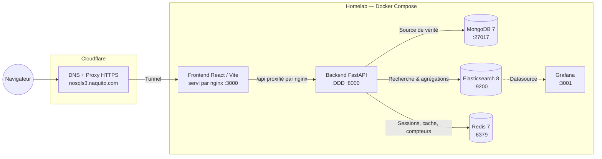

# PokéVinted

Projet NoSQL, ENSIIE S3. Maxence Tournaud, Arthur Pinel et Tony UY.

PokéVinted est une marketplace de cartes Pokémon entre particuliers, dans l'esprit de Vinted et Cardmarket, avec son propre nom et sa propre charte. Les annonces sont stockées dans MongoDB, indexées dans Elasticsearch et comptées dans Redis. Grafana affiche les statistiques du marché et l'état des services. Le tout tourne sous Docker Compose.

- Version en ligne : https://nosqls3.naquito.com/
- Dépôt : https://github.com/MiasMax/PROJET_NO_SQL_ENSIIE_S3

## Sommaire

1. [Consigne](#consigne)
2. [Fonctionnalités](#fonctionnalités)
3. [Architecture](#architecture)
4. [Choix des bases](#choix-des-bases)
5. [Modèle de données](#modèle-de-données)
6. [Flux de données](#flux-de-données)
7. [Démarrage](#démarrage)
8. [Constater la persistance](#constater-la-persistance)
9. [Hébergement](#hébergement)
10. [Sécurité](#sécurité)
11. [Tests](#tests)

## Consigne

Le sujet demandait une application web avec au moins un formulaire, des données persistées dans au moins deux bases, et un `docker-compose.yml` d'au moins trois conteneurs. Voici comment le projet y répond :

| Exigence | Dans le projet |
| :--- | :--- |
| Une page de formulaire | Le formulaire « Vendre une carte » |
| Au moins deux bases | MongoDB, Elasticsearch et Redis |
| Au moins trois conteneurs | Six : frontend, backend, MongoDB, Elasticsearch, Redis, Grafana |
| `git clone` puis `docker compose up` | Fonctionne sans configuration, voir [Démarrage](#démarrage) |
| Persistance vérifiable dans un terminal | Commandes prêtes dans [Constater la persistance](#constater-la-persistance) |
| Projet déployé | https://nosqls3.naquito.com/ |

## Fonctionnalités

### Marketplace

Le catalogue reprend les images HD officielles des séries 151, Flammes Obsidiennes, Écarlate et Violet et Faille Paradoxe. Au survol, les cartes s'inclinent avec un reflet holographique.

La barre de recherche passe par Elasticsearch et tolère les fautes de frappe. On peut filtrer par série, état et prix, et trier par prix ou par date. Chaque fiche carte affiche l'historique de ses prix de vente, mis en cache dans Redis.

On ajoute plusieurs cartes au panier et on les achète en une fois avec le portefeuille du compte, qui est rechargeable. Un bandeau montre les 5 annonces les plus consultées, mis à jour à chaque visite (Sorted Set Redis). Les favoris sont des Sets Redis, un par utilisateur.

Acheteur et vendeur peuvent discuter autour d'une annonce : les messages sont dans MongoDB, les compteurs de non-lus dans Redis. Le profil liste les annonces en cours, les ventes et les commandes, et permet de modifier le prix d'une annonce.

### Formulaire de vente

C'est la page formulaire demandée par la consigne. Le vendeur choisit la carte dans le catalogue, puis renseigne l'état, le prix, une description et, s'il le souhaite, une URL d'image. À l'envoi, l'annonce est écrite dans MongoDB, indexée dans Elasticsearch, et les compteurs Redis sont mis à jour. Le détail est dans [Flux de données](#flux-de-données).

### Boosters

Un studio permet d'ouvrir des boosters virtuels : on déchire le paquet, puis on révèle les cartes une par une, avec le dos de carte officiel. Les taux de tirage suivent les règles officielles d'Écarlate et Violet. Les cartes obtenues vont dans un classeur de collection qu'on peut fouiller, filtrer par série ou rareté, et trier.

### Comptes

Inscription, connexion et déconnexion sont disponibles. La session est stockée dans Redis pendant 24 h. Pour la démo, `sacha` et `ondine` se connectent en un clic, et `chen` est le compte administrateur.

L'Admin Dashboard, réservé aux administrateurs, affiche les statistiques des trois bases, relance l'amorçage des données, permet de supprimer des annonces et donne les commandes d'inspection à copier.

### Grafana

Les datasources et les dashboards sont déclarés par fichiers dans `grafana/provisioning/`. Il n'y a rien à configurer à la main.

Le dashboard « PokéVinted — Analytics NoSQL & Elasticsearch » se rafraîchit toutes les 5 s. Ses cinq panneaux viennent des agrégations Elasticsearch : chiffre d'affaires réalisé, annonces vendues, prix moyen, carte la plus chère en vente, et ventes comparées aux nouvelles annonces dans le temps.

Le dashboard « PokéVinted — État des conteneurs » suit la santé du stack sans Prometheus ni conteneur en plus. Toutes les 15 s, une sonde du backend ping MongoDB, Elasticsearch, Redis et l'API, puis écrit le résultat (UP ou DOWN, avec la latence) dans l'index Elasticsearch `pokevinted_health`. Le dashboard en tire l'état de chaque service, l'historique de disponibilité, la latence et un journal des relevés.

## Architecture



| Conteneur | Technologie | Rôle |
| :--- | :--- | :--- |
| `pokevinted-frontend` | React et Vite, build statique servi par nginx | Interface web. nginx relaie `/api` vers le backend |
| `pokevinted-backend` | Python FastAPI | API REST, logique métier, sonde de santé |
| `pokevinted-mongodb` | MongoDB 7 | Catalogue, annonces, utilisateurs, commandes, messages |
| `pokevinted-elasticsearch` | Elasticsearch 8.13, un seul nœud | Recherche, filtres, agrégations, relevés de santé |
| `pokevinted-redis` | Redis 7 | Sessions, cache, compteurs, tendances, favoris |
| `pokevinted-grafana` | Grafana | Dashboards sur Elasticsearch |

Le backend suit un découpage Domain-Driven Design. `domain/` contient les entités et les règles métier, sans dépendance aux bases. `application/use_cases/` contient les cas d'usage (créer une annonce, rechercher, acheter, valider un panier) qui passent par des interfaces de dépôts. Les implémentations MongoDB, Elasticsearch et Redis sont dans `infrastructure/persistence/`.

## Choix des bases

MongoDB est la source de vérité. Les cartes n'ont pas toutes les mêmes champs : une carte Pokémon a des PV, des attaques et un type d'énergie, une carte Dresseur a un effet, une carte Énergie n'a presque rien. Un modèle document accepte ces différences sans colonnes vides ni tables annexes.

Elasticsearch sert à la recherche. Il trouve les bonnes cartes même quand le nom est mal orthographié (`fuzziness: AUTO`), propose des résultats pendant la frappe et combine les filtres. Ses agrégations calculent les prix moyens et les ventes dans le temps, et Grafana les lit directement. Comme les annonces sont déjà des documents JSON dans MongoDB, on les indexe telles quelles.

Redis répond en moins d'une milliseconde. On l'utilise pour ce qui change souvent ou doit expirer : sessions, cache des recherches, compteurs (`INCR`, `INCRBYFLOAT`), classement des annonces les plus vues (Sorted Set), favoris (Sets) et fil des nouveautés (List).

## Modèle de données

### MongoDB, base `pokevinted`

| Collection | Contenu |
| :--- | :--- |
| `cards` | Catalogue officiel : nom, série, rareté, images |
| `listings` | Annonces : carte, prix, état, vendeur, description, statut (`ACTIVE` ou `SOLD`), acheteur, dates |
| `users` | Comptes, avec mot de passe haché |
| `orders` | Commandes |
| `messages` | Messages entre acheteur et vendeur |

### Elasticsearch

L'index `pokevinted_listings` a un mapping explicite :

- `card_name` : `text`, avec les sous-champs `keyword` et `search_as_you_type`
- `set_name`, `seller_name` : `text`, avec un sous-champ `keyword`
- `rarity`, `condition`, `status`, `buyer_name`, `card_id` : `keyword`
- `price` : `float`
- `created_at`, `sold_at` : `date`

La recherche est une requête `bool`. Un `multi_match` porte sur `card_name^3`, `card_name.suggest^2`, `set_name^2`, `seller_name` et `description` avec `fuzziness: AUTO`, et des filtres `term` et `range` s'y ajoutent avant le tri.

L'index `pokevinted_health` reçoit les relevés de la sonde : `@timestamp`, `service`, `container`, `status`, `status_label`, `latency_ms`.

### Redis

| Clé | Type | Usage |
| :--- | :--- | :--- |
| `session:<token>` | String JSON, TTL 24 h | Session utilisateur |
| `user:<id>:favorites` | Set | Annonces favorites |
| `listings:trending_views` | Sorted Set | Annonces les plus consultées |
| `listings:recent_ids` | List | 25 dernières annonces |
| `orders:recent_ids` | List | 25 dernières commandes |
| `stats:active_listings`, `stats:total_listings_created`, `stats:total_sales_count`, `stats:total_sales_volume` | Compteurs | Statistiques en direct |
| `cache:listings:*`, `cache:analytics:*` | String JSON, TTL | Cache des recherches et des analyses |
| `unread:*` | Compteurs | Messages non lus |
| `ratelimit:login:<user>` | Compteur | Limite des tentatives de connexion |

## Flux de données

### Mise en vente

1. Le backend vérifie que la carte existe dans le catalogue et que l'état est valide.
2. MongoDB reçoit le document de l'annonce, au statut `ACTIVE`.
3. Elasticsearch indexe l'annonce sous le même identifiant. Elle apparaît tout de suite dans la recherche.
4. Redis incrémente les compteurs d'annonces, ajoute l'identifiant en tête du fil des nouveautés et vide le cache de recherche.

Les écritures se font l'une après l'autre. MongoDB fait référence : on peut toujours reconstruire Elasticsearch et Redis à partir de lui.

### Recherche

`GET /api/listings` interroge Elasticsearch (texte approché, filtres, tri). Redis garde le résultat en cache, donc une requête identique ne refait pas la recherche.

### Consultation

`POST /api/listings/{id}/view` fait un `ZINCRBY` sur `listings:trending_views`, et le bandeau des tendances change aussitôt.

### Achat

1. Pour chaque annonce du panier, MongoDB passe le statut de `ACTIVE` à `SOLD` avec `find_one_and_update({_id, status: "ACTIVE"})`. L'opération est atomique : si deux acheteurs valident la même carte au même moment, un seul l'obtient.
2. La commande est enregistrée dans MongoDB et le portefeuille de l'acheteur est débité.
3. Elasticsearch réindexe l'annonce avec le statut `SOLD`.
4. Redis met à jour les compteurs de ventes et le chiffre d'affaires, retire l'annonce des tendances (`ZREM`) et vide les caches.

### Amorçage

Au premier démarrage, le backend remplit le catalogue et crée des annonces de départ et des comptes de démo. Les annonces partent vers Elasticsearch en une seule requête bulk. Les identifiants sont fixes, donc relancer l'amorçage ne crée pas de doublons.

## Démarrage

Il faut [Docker](https://docs.docker.com/get-docker/) et [Docker Compose](https://docs.docker.com/compose/).

```bash
git clone https://github.com/MiasMax/PROJET_NO_SQL_ENSIIE_S3.git
cd PROJET_NO_SQL_ENSIIE_S3
docker compose up --build

# (Alternative sur Windows si Docker est installé dans WSL2) :
# wsl docker compose up --build
```

Le `docker-compose.yml` contient des valeurs par défaut, donc pas besoin de `.env` pour lancer le projet. Pour changer les mots de passe, copiez `.env.example` en `.env` et modifiez-le : ses valeurs remplacent les valeurs par défaut.

Chaque service a un `healthcheck`. Le backend démarre une fois MongoDB, Elasticsearch et Redis prêts (`depends_on: condition: service_healthy`), et le frontend attend le backend. Chaque base a son volume nommé (`mongo_data`, `elastic_data`, `redis_data`, `grafana_data`), si bien que les données restent après un `docker compose down` suivi d'un `up`.

| Service | URL | Identifiants |
| :--- | :--- | :--- |
| Marketplace | http://localhost:3000 | Libre. Admin de démo : `chen` / `PokeAdmin2026!` |
| Swagger de l'API | http://localhost:8000/docs | Libre |
| Elasticsearch | http://localhost:9200 | Sans mot de passe, en local |
| Grafana | http://localhost:3001 | `admin` / `ChangeMe_Grafana_Admin_Password!`, modifiable dans `.env` |

Pour ouvrir l'Admin Dashboard, cliquez sur « Admin (Prof. Chen) » dans la fenêtre de connexion. Le pseudo se remplit ; tapez le mot de passe `PokeAdmin2026!`.

## Constater la persistance

### 1. Publier une annonce

1. Ouvrez http://localhost:3000 ou https://nosqls3.naquito.com/.
2. Cliquez sur « Vendre une carte » en haut à droite.
3. Choisissez par exemple Dracaufeu ex (Illustration Spéciale), un prix de `150` et le pseudo `Professeur_NoSQL`.
4. Cliquez sur « Publier l'annonce sur PokéVinted ».

### 2. Vérifier dans chaque base

Ouvrez un terminal par base. Les commandes utilisent les mots de passe par défaut ; remplacez-les si vous avez un `.env`. L'Admin Dashboard affiche aussi ces commandes.

MongoDB : l'annonce apparaît sous forme de document.

```bash
docker exec -it pokevinted-mongodb mongosh -u admin_pokevinted -p 'ChangeMe_P0k3V1nt3d_M0ng0_P@ssw0rd!' --authenticationDatabase admin pokevinted --eval "db.listings.find({seller_name: 'Professeur_NoSQL'}).pretty()"
```

```bash
# Annonces vendues et commandes
docker exec -it pokevinted-mongodb mongosh -u admin_pokevinted -p 'ChangeMe_P0k3V1nt3d_M0ng0_P@ssw0rd!' --authenticationDatabase admin pokevinted --eval "db.listings.find({status: 'SOLD'}).limit(5)"
docker exec -it pokevinted-mongodb mongosh -u admin_pokevinted -p 'ChangeMe_P0k3V1nt3d_M0ng0_P@ssw0rd!' --authenticationDatabase admin pokevinted --eval "db.orders.find().limit(5)"
```

Elasticsearch : le document est indexé et la recherche le trouve.

```bash
curl -s "http://localhost:9200/pokevinted_listings/_search?q=Professeur_NoSQL&pretty"
```

Ou depuis le conteneur backend :

```bash
docker exec -it pokevinted-backend curl -s "http://elasticsearch:9200/pokevinted_listings/_search?q=Professeur_NoSQL"
```

Redis : les compteurs ont augmenté et l'identifiant de l'annonce est en tête du fil.

```bash
# Compteurs d'annonces
docker exec -it pokevinted-redis redis-cli -a 'ChangeMe_P0k3V1nt3d_R3d1s_T0k3n!' MGET stats:active_listings stats:total_listings_created

# Fil des nouveautés : l'ID de la nouvelle annonce est en tête
docker exec -it pokevinted-redis redis-cli -a 'ChangeMe_P0k3V1nt3d_R3d1s_T0k3n!' LRANGE listings:recent_ids 0 2

# Top 5 des annonces les plus consultées
docker exec -it pokevinted-redis redis-cli -a 'ChangeMe_P0k3V1nt3d_R3d1s_T0k3n!' ZREVRANGE listings:trending_views 0 4 WITHSCORES
```

### 3. Redémarrer

```bash
docker compose down
docker compose up -d
```

Relancez les commandes : l'annonce est toujours là, grâce aux volumes nommés.

## Hébergement

La version en ligne tourne sur notre homelab, avec le même `docker-compose.yml` que dans le dépôt.

```
Navigateur ──HTTPS──▶ Cloudflare (DNS + proxy) ──tunnel──▶ Box du homelab ──▶ Docker Compose (frontend :3000)
```

Le domaine `nosqls3.naquito.com` est géré chez Cloudflare. Les visiteurs passent par le proxy Cloudflare, qui fournit le HTTPS et cache l'adresse IP du homelab. La box est reliée à Cloudflare par un tunnel et n'accepte que les connexions venant de Cloudflare.

Sur la machine, tous les ports des conteneurs sont liés à `127.0.0.1`, et aucune base n'est joignable depuis Internet. Seul le frontend est servi vers l'extérieur ; son nginx transmet les appels `/api` au backend sur le réseau Docker interne.

Pour déployer sur une autre machine :

```bash
git clone https://github.com/MiasMax/PROJET_NO_SQL_ENSIIE_S3.git
cd PROJET_NO_SQL_ENSIIE_S3
cp .env.example .env      # personnaliser les mots de passe
docker compose up -d --build
```

L'application répond ensuite sur `http://127.0.0.1:3000`. Il reste à la placer derrière un proxy ou un tunnel.

## Sécurité

Le compose définit deux réseaux : `pokevinted-public` pour le frontend et `pokevinted-internal` pour le backend et les bases. Tous les ports sont liés à `127.0.0.1`, jamais à `0.0.0.0`.

MongoDB exige un utilisateur et un mot de passe (`authSource=admin`), et Redis tourne avec `--requirepass`.

Le code ne contient aucun secret : les valeurs viennent de `.env`, ignoré par git, et `.env.example` sert de modèle. Les URI de connexion sont masquées dans les logs (`******`). L'API ne renvoie jamais de mot de passe ; les commandes de l'Admin Dashboard utilisent les variables shell `$MONGO_ROOT_PASSWORD` et `$REDIS_PASSWORD`.

Les routes d'administration (`/api/admin/stats`, `/api/admin/seed`, suppression d'annonces) demandent une session administrateur et répondent `401` ou `403` sinon. Les mots de passe sont hachés en PBKDF2-HMAC-SHA256 avec 100 000 itérations. Redis limite les tentatives de connexion, et CORS n'accepte que les origines du frontend.

Chaque conteneur a une limite mémoire (`mem_limit`), et le heap d'Elasticsearch est fixé à 512 Mo (`ES_JAVA_OPTS=-Xms512m -Xmx512m`).

## Tests

Le backend a des tests unitaires sur le domaine et les cas d'usage, et des tests d'intégration sur l'API.

```bash
cd backend
python -m pytest tests -v
```
