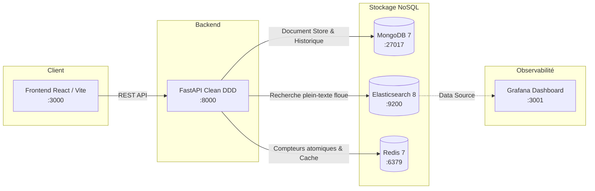

# 🎴 PokéVinted — Marketplace Pokémon Multi-NoSQL

> **Projet NoSQL — ENSIIE S3**  
> Une marketplace de cartes Pokémon haute performance inspirée de *Vinted* et *Cardmarket*, architecturée selon les principes du **Domain-Driven Design (DDD)** et orchestrée sous **Docker Compose**.  
> Persistance conjointe et cohérente sur **MongoDB**, **Elasticsearch** et **Redis**, avec supervision temps-réel via **Grafana**.

---

## 🌟 Fonctionnalités Clés

1. **Marketplace Moderne & Réactif (Style Vinted)** :
   * Consultation du catalogue officiel avec **images officielles HD** (*151, Flammes Obsidiennes, Écarlate et Violet, Faille Paradoxe*).
   * **Effet 3D Holographique interactif** au survol des cartes (inclinaison tilt et reflet spéculaire dynamique).
   * Recherche instantanée tolérante aux fautes de frappe (*fuzzy search*) avec filtres par série, état d'usure et tri par prix.
   * Achat express simulé avec protection acheteur et archivage immuable des commandes.

2. **Formulaire de Vente & Double Persistance (Consigne Enseignant)** :
   * Formulaire complet de publication d'annonce (choix de carte, état, prix, description, pseudo vendeur).
   * Lors de la soumission, la donnée est persistée instantanément dans :
     * 🟢 **MongoDB** : Source de vérité principale (Document Store).
     * 🔵 **Elasticsearch** : Indexation immédiate pour recherche plein-texte.
     * 🔴 **Redis** : Compteurs atomiques, flux FIFO des nouveautés et purge du cache.

3. **Bilan Admin & Supervision Temps-Réel** :
   * Métriques financières (volume total en €, commandes passées, annonces actives).
   * **Vérificateur de cohérence** (audit de synchronisation entre MongoDB et Elasticsearch).
   * **Boîte à outils Soutenance** : boutons pour copier les commandes exactes à jouer dans les terminaux.
   * Dashboard **Grafana** préconfiguré sur le port `3001`.

---

## 🏗️ Architecture & Synergie des 3 Systèmes NoSQL



| Moteur NoSQL | Type | Rôle Métier |
| :--- | :--- | :--- |
| **MongoDB** | Document Store | **Source de vérité** : stocke le catalogue des cartes officielles, les fiches complètes des annonces et l'historique immuable des commandes. |
| **Elasticsearch** | Search Engine | **Recherche textuelle** : indexe les annonces avec analyseurs de texte, recherche floue (*fuzzy match* sur les noms de Pokémon et illustrateurs) et facettes. |
| **Redis** | In-Memory Key-Value | **Haute performance** : compteurs atomiques (`INCR`, `INCRBYFLOAT`), liste FIFO des dernières annonces (`LPUSH`), et suivi de popularité (*Sorted Sets*). |

---

## 🚀 Démarrage Rapide (En une seule commande)

### Prérequis
* [Docker](https://docs.docker.com/get-docker/) et [Docker Compose](https://docs.docker.com/compose/) installés.

### Lancer le projet
```bash
# 1. Cloner le dépôt
git clone <URL_DU_REPO_GITHUB>
cd PROJET_NO_SQL_ENSIIE_S3

# 2. Lancer l'orchestration complète
docker compose up --build
```

Au démarrage, un script d'amorçage (**seed**) peuple automatiquement le catalogue avec les cartes de référence et quelques annonces de départ.

### Points d'accès de l'application
| Service | URL | Identifiants |
| :--- | :--- | :--- |
| **Marketplace (Frontend)** | `http://localhost:3000` | Accès libre |
| **Documentation API (Swagger)** | `http://localhost:8000/docs` | Accès libre |
| **Elasticsearch** | `http://localhost:9200` | Sans mot de passe |
| **Grafana** | `http://localhost:3001` | `admin` / `admin` |

---

## 🎓 Guide d'Évaluation pour l'Enseignant (Soutenance)

Pour constater en direct la persistance multi-systèmes lors de la saisie d'un formulaire :

### Étape 1 : Publier une annonce sur l'interface
1. Ouvrez `http://localhost:3000`.
2. Cliquez sur **« Vendre une carte »** en haut à droite.
3. Remplissez le formulaire :
   * Choisissez par exemple **Dracaufeu ex (Illustration Spéciale)**.
   * Fixez un prix (ex : `150`).
   * Renseignez votre pseudo (ex : `Professeur_NoSQL`).
   * Cliquez sur **« Publier l'annonce sur PokéVinted »**.

---

### Étape 2 : Vérification dans les terminaux

Ouvrez **3 terminaux distincts** pour interroger chacun des 3 systèmes :

#### Terminal 1 — Constat de persistance dans **MongoDB**
```bash
docker exec -it pokevinted-mongodb mongosh pokevinted --eval "db.listings.find({seller_name: 'Professeur_NoSQL'}).pretty()"
```
> 👉 *L'annonce complète apparaît sous forme de document JSON BSON structuré.*

#### Terminal 2 — Constat d'indexation dans **Elasticsearch**
```bash
curl -s "http://localhost:9200/pokevinted_listings/_search?q=Professeur_NoSQL" | jq '.hits.hits[]._source | {id, card_name, price, seller_name, status}'
```
> 👉 *Le document a été indexé en temps réel et est immédiatement requêtable.*

#### Terminal 3 — Constat des compteurs dans **Redis**
```bash
docker exec -it pokevinted-redis redis-cli MGET stats:active_listings stats:total_listings_created
```
```bash
# Vérifier l'ajout dans la liste des nouveautés
docker exec -it pokevinted-redis redis-cli LRANGE listings:recent_ids 0 2
```
> 👉 *Les compteurs atomiques ont été incrémentés et l'ID de l'annonce est en tête de file.*

---

## 🧪 Tests Automatisés (TDD)

L'application suit une rigoureuse méthodologie TDD (Domain & Use Cases isolés + intégration API).

Pour exécuter les tests :
```bash
cd backend
python -m pytest tests -v
```

---

## 🌐 Déploiement sur Serveur Cloud (VPS)

Pour déployer sur un VPS (OVH, Hetzner, DigitalOcean, AWS EC2, etc.) :

1. Se connecter en SSH à votre machine distante :
   ```bash
   ssh root@<IP_DU_SERVEUR>
   ```
2. Installer Docker et Docker Compose :
   ```bash
   curl -fsSL https://get.docker.com | sh
   ```
3. Cloner et démarrer :
   ```bash
   git clone <URL_DU_REPO_GITHUB>
   cd PROJET_NO_SQL_ENSIIE_S3
   docker compose up -d --build
   ```
4. L'application est immédiatement accessible publiquement sur `http://<IP_DU_SERVEUR>:3000`.

---

## 👥 Équipe Projet
* **Membres** : [À compléter avec vos noms]
* **Formation** : ENSIIE — Semestre S3
* **Module** : Bases de Données NoSQL